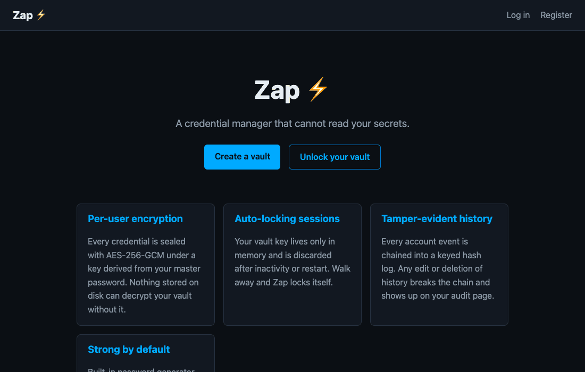
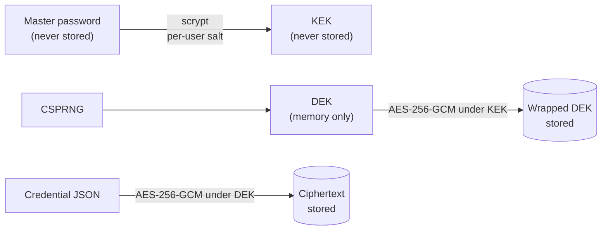
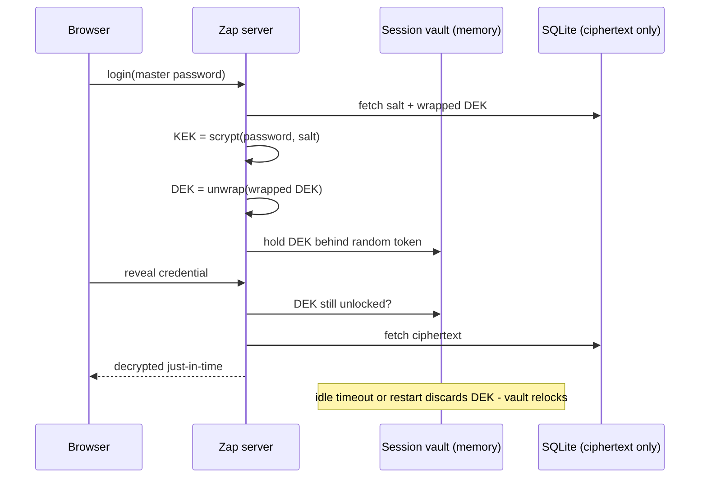
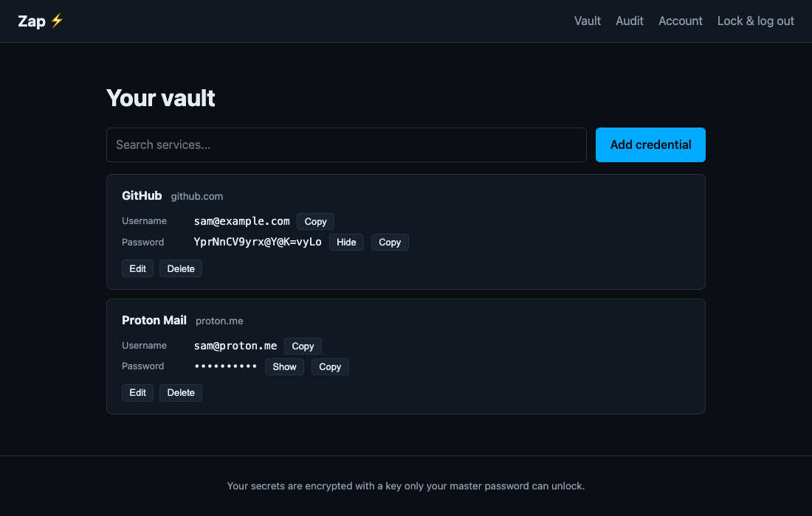
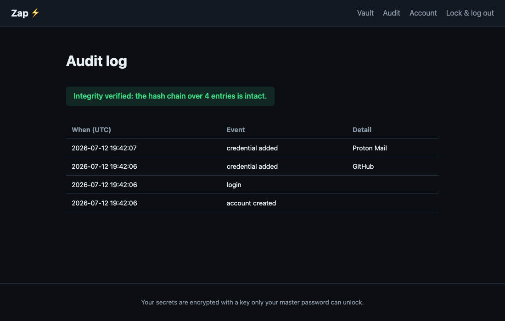

# Zap - Secure Credential Manager

[](https://github.com/samjo2/Zap-Secure-Credential-Manager/actions/workflows/ci.yml)

Zap is a self-hosted credential manager built on one rule: **nothing stored on
disk can decrypt your vault without your master password.** There is no global
encryption key, and the server never persists key material that could open
your data.



## How the encryption works

Each user gets a random 256-bit data-encryption key (DEK) that encrypts their
credentials with AES-256-GCM. The DEK itself is stored only in wrapped form,
sealed under a key-encryption key (KEK) derived from the user's master
password with scrypt:



At login the KEK is derived, the DEK unwrapped, and the DEK held **only in
server memory**, tied to your session and discarded after 15 minutes of
inactivity or any restart. Losing the master password means losing the vault;
that is the point.



Each ciphertext is bound to its owner and row (AES-GCM associated data), so
moving an encrypted blob to another user or credential fails to decrypt.

## Features

- **Per-user envelope encryption** - AES-256-GCM under a scrypt-derived key;
  usernames, passwords, and notes are all ciphertext at rest.
- **Auto-locking vault** - the unwrapped key lives in memory with a sliding
  idle timeout; walking away or restarting the server relocks everything.
- **Tamper-evident audit log** - every account event is chained with keyed
  HMAC-SHA256 hashes. Editing or deleting history breaks the chain, and the
  audit page shows it.
- **Hardened auth** - scrypt password hashing, login throttling that locks an
  attacker's IP without letting them lock *you* out, uniform error messages,
  timing-leveled username lookup, session fixation defense.
- **Real password reset** - expiring single-use emailed tokens. Resetting
  without the old password erases the vault (it is mathematically
  unrecoverable) and says so up front; changing your password *with* the old
  one re-wraps the key and keeps everything.
- **CSRF protection everywhere**, strict Content-Security-Policy, no inline
  scripts, security headers on every response.
- **Password generator** with length/symbol options, strength feedback while
  you type.
- **Browser extension** - autofills the single best-matching credential for
  the current domain; it can never download the whole vault.

## Screenshots

| Vault | Audit log |
|---|---|
|  |  |

## Getting started

Requires Python 3.10+.

```bash
git clone https://github.com/samjo2/Zap-Secure-Credential-Manager.git
cd Zap-Secure-Credential-Manager
python3 -m venv .venv
source .venv/bin/activate        # Windows: .venv\Scripts\activate
pip install -r requirements.txt
python app.py
```

Open http://127.0.0.1:5000, register, and start adding credentials. The
SQLite database and a persisted secret key are created under `instance/`
(both are gitignored and chmod 600).

### Configuration (all optional)

| Variable | Default | Purpose |
|---|---|---|
| `ZAP_SECRET_KEY` | auto-generated, persisted in `instance/` | Session signing + audit HMAC key |
| `ZAP_DB_PATH` | `instance/zap.db` | SQLite database location |
| `ZAP_VAULT_TIMEOUT_MINUTES` | `15` | Idle minutes before the vault relocks |
| `ZAP_HTTPS` | unset | Set to `1` behind TLS to mark cookies Secure |
| `ZAP_DEBUG` | unset | Set to `1` for the Flask debugger (never in production) |
| `ZAP_SMTP_HOST/PORT/USERNAME/PASSWORD/SENDER` | unset | Send reset emails; otherwise reset links are logged to the console |

See `.env.example`. Run with a single process (the in-memory session vault is
process-local): `python app.py` or `gunicorn -w 1 'zap:create_app()'`.

## Running the tests

```bash
pip install -r requirements-dev.txt
python -m pytest
```

The suite includes dispositive security checks: it reads the raw SQLite file
to prove secrets and master passwords are ciphertext at rest, tampers with
audit rows to prove the hash chain catches it, and verifies one user gets 404s
on another's credentials.

## Where the blockchain went

The original version hashed `service:username:password` with keccak256 and
published it to an Ethereum testnet. That was a security hole, not a feature:
a public, offline-crackable digest of every stored password (and the testnet,
Rinkeby, has since shut down). The goal it aimed at - tamper-evident history -
is now served by the local HMAC hash chain on the audit page, which publishes
nothing. If external anchoring is ever wanted, the safe design is to
periodically anchor the chain *head* (a single keyed hash) somewhere public;
per-credential data must never leave the machine.

## Project structure

```
Zap-Secure-Credential-Manager/
├── app.py                # Entry point
├── zap/
│   ├── __init__.py       # App factory, config, security headers
│   ├── auth.py           # Register, login, throttling, change/reset password
│   ├── vault.py          # Credential CRUD, autofill + generator APIs
│   ├── security.py       # KDF, DEK wrap/unwrap, session vault, CSRF
│   ├── audit.py          # HMAC hash-chain audit log
│   ├── throttle.py       # Login rate limiting
│   ├── mailer.py         # Reset emails (optional SMTP)
│   ├── db.py / schema.sql
│   ├── templates/ static/
├── extension/            # Chrome autofill extension (see its README)
├── tests/                # pytest suite
└── SECURITY.md           # Threat model and crypto details
```

## Threat model, in one paragraph

Zap protects your credentials against theft of the database file, a server
snapshot, or backups: an attacker gets only ciphertext and scrypt-cost salted
verifiers. It does **not** protect against an attacker with live root access
to a running server while you are logged in (they could read process memory),
nor against malware on your own browser. Full details, including why the
server sees plaintext transiently and what a zero-knowledge client-side
upgrade would look like, are in [SECURITY.md](SECURITY.md).

## License

MIT - see [LICENSE](LICENSE).

## Contact

- Email: samsonjoh73@gmail.com
- Issues: https://github.com/samjo2/Zap-Secure-Credential-Manager/issues
